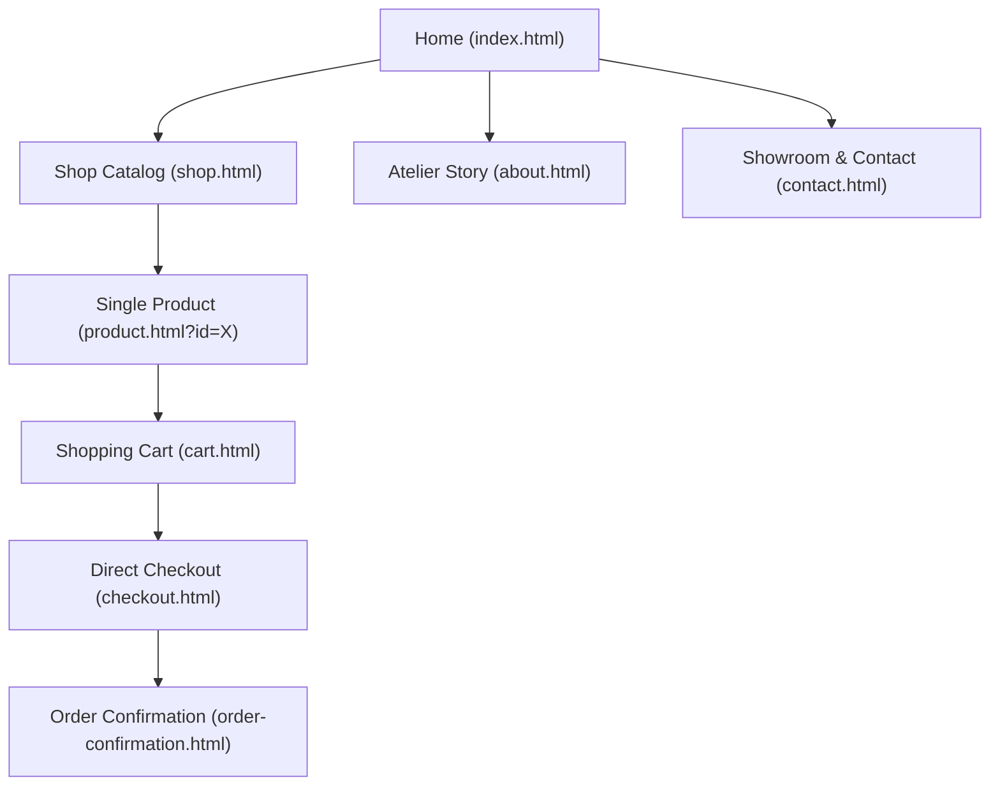

# CLARA Bags — E-Commerce Architecture & WordPress Block Theme Blueprint

Comprehensive business analysis, brand profile, multi-page WooCommerce architecture, and technical implementation plan for **CLARA (Clara Bags Sri Lanka)**.

---

## 1. Executive Summary & Brand Profile

| Attribute | Details |
| :--- | :--- |
| **Brand Name** | **CLARA** (operating as **Clara Bags** / **Clara Bags Sri Lanka**) |
| **Parent / Registered Entity** | DJ Industries (`sl.djindustries@gmail.com`) |
| **Industry & Niche** | Handcrafted Luxury Handbags, Structured Vanity Bags, Executive Laptop Totes, Evening Minaudières, Travel Holdalls & Wallets |
| **Business Model** | Omnichannel: Physical Flagship Boutique + Full Online E-Commerce + Wholesale Distribution (B2B) |
| **Physical Flagship** | **No. 587/A, Galle Road, Mount Lavinia, Sri Lanka** (Prime commercial strip along Galle Road) |
| **Operating Hours** | Open 7 Days a Week: 9:30 AM – 7:30 PM (Walk-in retail shoppers & wholesale consultations) |
| **Contact Hotlines** | **Mobile / WhatsApp:** `+94 77 317 3217` (`077 317 3217`)<br>**Boutique Landline:** `+94 11 703 7030` (`011 703 7030`) |
| **Official Emails** | `clara2bags@gmail.com` (Client care & orders)<br>`sl.djindustries@gmail.com` (Corporate registry & wholesale) |
| **Target Domain** | `clarabags.lk` |
| **Social Presence & Proof** | **Facebook:** 16,000+ patrons, 94% customer recommendation index<br>**Instagram:** `@clara_bags`<br>**TikTok:** `CLARA` |
| **Brand Philosophy** | *"We create the new fashion and trend in the bag industry as it is the blooming business in today's world, and what more than a staple than a great handbag."* |

---

## 2. Brand Visual Identity & Design System

The visual identity is designed to rival international luxury houses (*Polène Paris, Celine, Jacquemus, Charles & Keith*):

```
[ Deep Obsidian / Onyx ]      #0E0E10 / #1A1A1E    (Primary luxury anchors, footers, dark accents)
[ Warm Silk Alabaster / Ecru ] #FAF8F5 / #F4F0E8    (Tactile canvas, warm light card backgrounds)
[ Muted Champagne Gold ]       #C5A880 / #A68A68    (Subtle hardware accents, badges, trust notes)
[ Deep Tuscan Wine / Red ]     #7A1B24 / #561118    (Heritage rose accent, active states, buttons)
[ Pure Alabaster White ]       #FFFFFF              (Clean product surfaces and form inputs)
```

### Typography Hierarchy
* **Editorial Display (Serif):** `Cormorant Garamond` (weights 300, 400, 500 italic) — architectural elegance, editorial headlines, and product names.
* **Modern Interface (Sans-Serif):** `Plus Jakarta Sans` — ultra-legible UI, tracked uppercase labels (`tracking-ultra: 0.22em`, `tracking-mega: 0.32em`), specs tables, and checkout forms.

---

## 3. Dedicated Multi-Page WooCommerce Information Architecture

The website is engineered as a **true multi-page e-commerce store** ready for direct WooCommerce Block Theme mapping:



### Page Breakdown & Template Mapping

| Page File | Purpose | WooCommerce Block Theme Equivalent |
| :--- | :--- | :--- |
| [`index.html`](file:///home/vjranga/Documents/CLARA/index.html) | Editorial homepage with campaign hero, category showcase, featured silhouettes, and flagship invite. | `templates/index.html` (Front Page Block Template) |
| [`shop.html`](file:///home/vjranga/Documents/CLARA/shop.html) | Complete catalog archive with real-time category pills (`?cat=vanity`, `?cat=totes`), live search, and sorting. | `templates/archive-product.html` (Product Archive Block Template) |
| [`product.html`](file:///home/vjranga/Documents/CLARA/product.html) | Single Product Page (PDP) with multi-image gallery, interactive color swatches, quantity stepper, Add to Cart, Buy Now, and related items. | `templates/single-product.html` (Single Product Block Template) |
| [`cart.html`](file:///home/vjranga/Documents/CLARA/cart.html) | Dedicated shopping cart with item table, voucher code system (`WELCOME10`), shipping destination calculator, and live totals. | `templates/page-cart.html` (WooCommerce Cart Block) |
| [`checkout.html`](file:///home/vjranga/Documents/CLARA/checkout.html) | 2-column direct online checkout: contact info, delivery address, shipping method radio cards, and multi-payment options. | `templates/page-checkout.html` (WooCommerce Checkout Block) |
| [`order-confirmation.html`](file:///home/vjranga/Documents/CLARA/order-confirmation.html) | Dedicated order received receipt with unique order ID (`#CL-XXXXX`), itemized receipt, bank deposit instructions, and print option. | `templates/order-received.html` (WooCommerce Order Received) |
| [`about.html`](file:///home/vjranga/Documents/CLARA/about.html) | The story of CLARA Bags, material craftsmanship, and Mount Lavinia boutique philosophy. | `templates/page-about.html` |
| [`contact.html`](file:///home/vjranga/Documents/CLARA/contact.html) | Showroom address, opening hours (9:30 AM – 7:30 PM), phone hotlines, contact form, and embedded Google Map. | `templates/page-contact.html` |

---

## 4. Online Checkout & Payment Architecture

Customers complete their orders **directly online through the website** using a full multi-payment gateway:

1. **Credit / Debit Card (Online Payment):**
   * Instant online card payment (Visa, Mastercard, Amex via PayHere, WebXpay, or OnePay).
2. **Direct Bank Deposit / Bank Transfer (BACS):**
   * Corporate account details displayed directly during checkout:
     * **Bank:** Commercial Bank of Ceylon PLC
     * **Account Name:** CLARA BAGS (DJ INDUSTRIES)
     * **Account Number:** 8003492819
     * **Branch:** Mount Lavinia
   * Client receives order number reference and uploads deposit slip photo.
3. **Cash on Delivery (COD):**
   * Standard Sri Lankan doorstep payment upon inspecting the package.
4. **Showroom Pickup:**
   * Reserve item online and collect in person at No. 587/A Galle Road, Mount Lavinia.

### Shipping & Courier Matrix
* **Colombo & Western Province:** 1–2 business days (Rs. 350 flat rate).
* **Islandwide Outstations:** 2–4 business days via Domex, Pronto, or Certis Lanka (Rs. 550 flat rate).
* **Complimentary Shipping:** Automatic free delivery on orders over **Rs. 10,000**.

---

## 5. Technical Stack & WordPress Migration Plan

### Front-End Prototype Stack (Ready Now)
* **HTML5:** Clean semantic markup structured identically to Gutenberg block patterns.
* **Tailwind CSS + Custom Luxury CSS (`css/main.css`):** Bespoke design tokens, Cormorant Garamond / Plus Jakarta typography, and smooth transitions.
* **JavaScript Engine (`js/products-data.js` & `js/store.js`):** Unified catalog and shopping engine syncing cart items, coupons, totals, and orders across all pages via `localStorage`.

### WordPress Block Theme (FSE) Production Transition
1. **`theme.json` Configuration:**
   * Global typography: Cormorant Garamond (headings) & Plus Jakarta Sans (body).
   * Color palette: Obsidian (`#0E0E10`), Warm Silk (`#FAF8F5`), Champagne Gold (`#C5A880`), Wine (`#7A1B24`).
2. **Custom Block Patterns:**
   * `clara/hero-editorial`
   * `clara/category-grid`
   * `clara/product-specs-accordion`
   * `clara/showroom-locator`
3. **WooCommerce Blocks:**
   * Use native WooCommerce Cart & Checkout blocks for 1-page frictionless checkout.
   * Configure PayHere Payment Gateway plugin for card processing and native BACS for bank transfers.
